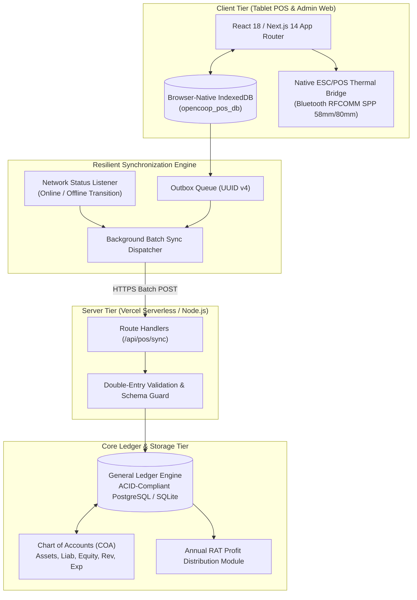
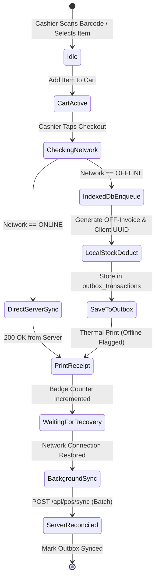
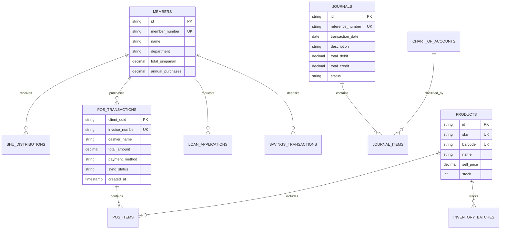

# 🏛️ OpenCoop Enterprise ERP & Offline-First POS Engine

> **Sanitized Production-Grade Architecture Showcase**  
> *A high-throughput, offline-capable enterprise cooperative ERP & retail POS system engineered for reliability, financial accuracy, and zero-downtime operations.*

[](https://nextjs.org/)
[](https://www.typescriptlang.org/)
[](https://developer.mozilla.org/en-US/docs/Web/API/IndexedDB_API)
[](https://tailwindcss.com/)
[](LICENSE)
[](https://vercel.com)

---

## 📌 Executive Summary

**OpenCoop** (NusaCoop Enterprise) is an architectural boilerplate and sanitized live showcase derived from a mission-critical cooperative ERP system built and maintained in live production (>1 year development, 2+ months operational stability with **0 downtime**). 

The system was engineered to solve three fundamental challenges in cooperative management and campus retail:
1. **Zero-Latency Offline Checkout:** Preventing revenue loss during network outages using client-side **IndexedDB caching** and asynchronous conflict-free background outbox synchronization.
2. **Double-Entry Financial Integrity:** Enforcing strict SAK-ETAP accounting rules with an autonomous **General Ledger (GL)** engine where debit/credit discrepancies are blocked at runtime.
3. **Automated SHU RAT Allocation:** Slashing annual dividend calculation cycles from **3 business days of manual spreadsheet reconciliation to under 15 seconds** based on Indonesian Cooperative Law (*UU No. 25/1992*).

---

## 🏗️ System Architecture & Data Flow

### 1. High-Level Enterprise Architecture



---

### 2. Offline-First POS Transaction State Machine



---

### 3. Entity-Relationship Data Model (ERD)



---

## ⚡ Core Feature Specifications

### 1. Offline-First POS & Thermal Printing Bridge
* **Browser-Native IndexedDB Storage:** Uses `opencoop_pos_db` with dedicated object stores (`products`, `outbox_transactions`, `metadata`) eliminating third-party client database bloat.
* **Instant Stock Decrement:** Decrements local inventory caches in real-time during network blackouts to prevent cashier overselling.
* **ESC/POS Hardware Bridge:** Formats print receipts according to standard 58mm/80mm thermal specifications with simulated Bluetooth RFCOMM SPP socket bridge.
* **Zero Transaction Loss:** Client-generated RFC4122 UUID v4 ensures idempotency and conflict-free server reconciliation upon reconnect.

### 2. General Ledger & Double-Entry Accounting
* **SAK-ETAP Standard Chart of Accounts (COA):** Structured across standard accounts (1000 Assets, 2000 Liabilities, 3000 Equity, 4000 Revenue, 5000 COGS, 6000 Operating Expenses).
* **Strict Runtime Balanced Validation:** Journal posting is prevented unless $\sum \text{Debit} \equiv \sum \text{Credit}$ ($0\text{ discrepancy}$).
* **Real-Time Financial Statements:** Generates dynamic Balance Sheets (*Neraca*) and Income Statements (*Laporan Laba Rugi*) on demand.

### 3. Member Savings & Automated Payroll Deductions
* **Three-Tier Savings Ledger:** Tracks mandatory principal (*Simpanan Pokok*), monthly recurring (*Simpanan Wajib*), and liquid voluntary (*Simpanan Sukarela*) accounts.
* **Loan Amortization Engine:** Computes monthly principal and cooperative margin schedules with automated payroll deduction (*potong gaji*) integration for institutions.

### 4. Annual SHU RAT Profit Sharing Calculator
* **Statutory Compliance:** Automatically divides net profit based on Article 34 of Indonesian Law No. 25/1992:
  $$\text{SHU Anggota} = \left( \frac{\text{Simpanan Anggota}}{\text{Total Simpanan Koperasi}} \times \text{Alokasi Jasa Modal} \right) + \left( \frac{\text{Transaksi Anggota}}{\text{Total Omset Belanja}} \times \text{Alokasi Jasa Usaha} \right)$$
* **Real-Time Slips:** Generates printable individual member dividend distribution slips with audited breakdown.

---

## 🚀 Live Sandbox Demo & Quick Start

### 🌐 Live Demo URL
Deployable instantly to Vercel:
```bash
https://opencoop-enterprise-demo.vercel.app
```

### 🔑 Demo Role Switcher
The sandbox UI features a one-click **Role Switcher** in the top navigation bar:
| Role | Capabilities | Primary View |
| :--- | :--- | :--- |
| **Admin** | Full access to General Ledger, Member Savings, Journal Postings, and SHU RAT. | `/ledger`, `/shu` |
| **Kasir (Cashier)** | Fast POS checkout, offline simulator toggle, thermal receipt generation. | `/pos` |
| **Pengawas (Auditor)** | Read-only view of Audit Trails, Balance Sheet, and Reconciliation Logs. | `/ledger` |

---

## 🛠️ Local Development Setup

### 1. Clone the Clean Repository
```bash
git clone https://github.com/BroAegg/opencoop-enterprise-demo.git
cd opencoop-enterprise-demo
```

### 2. Install Dependencies
```bash
npm install
```

### 3. Run Development Server
```bash
npm run dev
```
Open [http://localhost:3000](http://localhost:3000) in your browser.

### 4. How to Test the Offline-First Mechanism:
1. Open [http://localhost:3000/pos](http://localhost:3000/pos).
2. Click **"Uji Mode Offline Kasir"** on the top status bar (or disconnect WiFi in Chrome DevTools Network tab).
3. Add products to the cart and click **"SIMPAN KE INDEXEDDB OFFLINE"**.
4. Notice the **Thermal Receipt** generated with the `* TERSIMPAN SECARA LOKAL (INDEXEDDB) *` flag.
5. Inspect **Chrome DevTools → Application → IndexedDB → `opencoop_pos_db` → `outbox_transactions`** to inspect the stored payload.
6. Click **"Kembalikan ke Mode Online"** and tap **"Sync Now"** to watch the background sync commit to the server.

---

## 🚢 1-Click Vercel Deployment

Deploy this demo to Vercel with zero environment variable configuration required:

1. Push your repository to GitHub:
   ```bash
   git add .
   git commit -m "feat: initial sanitized enterprise cooperative demo"
   git branch -M main
   git remote add origin https://github.com/BroAegg/opencoop-enterprise-demo.git
   git push -u origin main
   ```
2. Import the repository in [Vercel Dashboard](https://vercel.com/new).
3. Click **Deploy** (framework preset: Next.js).

---

## 🔒 Privacy & Sanitization Notice

This repository represents a **clean-room architecture demo**. All member identities, personal phone numbers, bank accounts, university affiliations, and proprietary credentials have been **100% removed and replaced with realistic synthetic test fixtures**. No production data from Koperasi Muhammadiyah Bandung (Bermadani) is contained herein.

---

## 👨‍💻 Author & Engineering Credits

* **Lead Architect & Engineer:** [Aegner Billik](https://linkedin.com/in/aegnerbillik)
* **GitHub:** [@BroAegg](https://github.com/BroAegg)
* **Portfolio:** [Technical Portfolio](https://aegneru-portof-dun.vercel.app)
